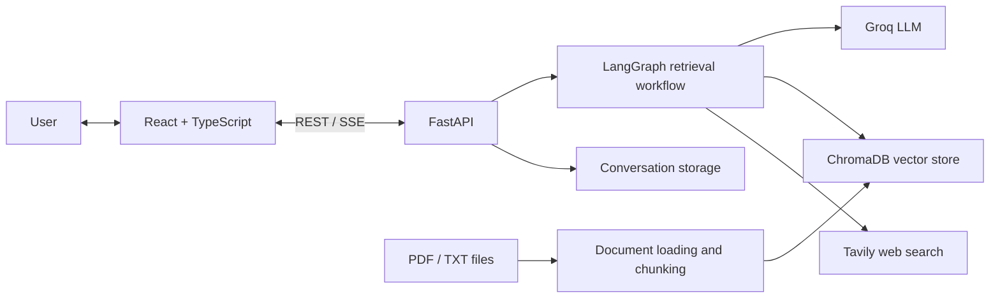

# Knowra — Ask. Retrieve. Understand.

[](https://multi-source-rag-chatbot-with-dynamic.onrender.com/)
[](https://react.dev/)
[](https://fastapi.tiangolo.com/)
[](https://github.com/langchain-ai/langgraph)
[](https://www.trychroma.com/)

**Knowra is a multi-source Retrieval-Augmented Generation (RAG) chatbot** that routes questions to the most appropriate source: the language model, documents you provide, or live web search. It combines a React interface with an asynchronous FastAPI backend and LangGraph-based retrieval orchestration.

> **Demo note:** The hosted demo may take a little time to wake up after inactivity. Cloud instances can have temporary storage, so do not rely on a public demo to retain uploaded documents or conversations permanently.

## Contents

- [Why Knowra?](#why-knowra)
- [Features](#features)
- [How retrieval works](#how-retrieval-works)
- [Architecture](#architecture)
- [Technology stack](#technology-stack)
- [Try the live demo](#try-the-live-demo)
- [Run locally](#run-locally)
- [Configuration](#configuration)
- [Use your own documents](#use-your-own-documents)
- [Docker deployment](#docker-deployment)
- [API overview](#api-overview)
- [Testing](#testing)
- [Project structure](#project-structure)
- [Known deployment considerations](#known-deployment-considerations)
- [Security](#security)
- [License](#license)

## Why Knowra?

A conventional RAG workflow may retrieve documents for every question, even when retrieval is unnecessary. Knowra supports different retrieval paths so the application can answer general questions directly, consult an indexed local knowledge base, or search the web for information that may be current.

## Features

- **Dynamic retrieval:** Routes between native LLM responses, local vector retrieval, and web search.
- **Streaming responses:** Streams generated output to the interface using Server-Sent Events (SSE).
- **Stop generation:** Lets the user cancel an active response.
- **Conversation management:** Start conversations, switch between saved threads, and continue previous chats.
- **Document management:** Upload PDF/TXT files and rebuild the local vector index.
- **Retrieval controls:** Choose a model and select dynamic or a specific retrieval mode where supported by the UI.
- **Evaluation interface:** Run the included evaluation workflow and inspect its reported results.
- **Responsive chat interface:** React, TypeScript, Tailwind CSS, Markdown rendering, and light/dark theme support.

## How retrieval works

| Mode | What it does | Typical use |
| --- | --- | --- |
| **Dynamic** | Uses the application's routing logic to choose a retrieval path. | General-purpose questions |
| **LLM Native** | Generates a response without retrieving local documents. | General questions, reasoning, and conversation |
| **Vectorstore** | Retrieves relevant chunks from documents indexed in ChromaDB. | Questions grounded in your own PDFs or text files |
| **Web Search** | Uses the configured Tavily search integration. | Current information or questions that need web sources |

The response route depends on the selected mode and the application's routing logic. As with any generative AI system, answers should be checked against the cited or retrieved sources for important decisions.

## Architecture



The React single-page application is built into `frontend/dist/` and served by FastAPI in the packaged application. The vector store and conversation files use local filesystem paths by default.

## Technology stack

| Layer | Technologies |
| --- | --- |
| Frontend | React 19, TypeScript, Vite, Tailwind CSS v4, Lucide React |
| API | Python, FastAPI, Uvicorn, Server-Sent Events |
| Orchestration | LangChain, LangGraph, LangChain-Groq |
| Language model | Groq API; default model configured as `openai/gpt-oss-120b` |
| Document retrieval | ChromaDB, Sentence Transformers, `all-MiniLM-L6-v2` |
| Web search | Tavily |
| Tests | Python unit/integration tests and Playwright end-to-end workflow tests |

## Try the live demo

**[Open Knowra →](https://multi-source-rag-chatbot-with-dynamic.onrender.com/)**

For a quick exploration:
1. Open the app and wait for the service to finish waking up if needed.
2. Try a general question in Dynamic or LLM Native mode.
3. Try Web Search for a question that benefits from current web sources.
4. To test document-grounded answers, upload a PDF/TXT document in Data Management and rebuild the vector store if the deployment permits it.

The hosted service is a demonstration environment. Availability, response time, and persistence depend on the hosting platform and its current configuration.

## Run locally

### Prerequisites

- Python 3.12 recommended
- Node.js and npm only if you want to rebuild or develop the frontend
- A [Groq API key](https://console.groq.com/)
- A [Tavily API key](https://tavily.com/) for web search

### 1. Clone the repository

```bash
git clone https://github.com/faaizhamid07/Multi-Source-RAG-Chatbot-with-Dynamic-Retrieval-.git
cd Multi-Source-RAG-Chatbot-with-Dynamic-Retrieval-
```

### 2. Create a virtual environment and install dependencies

**Windows PowerShell**
```powershell
py -3.12 -m venv .venv
.\.venv\Scripts\Activate.ps1
python -m pip install --upgrade pip
pip install -r requirements.txt
```

**macOS / Linux**
```bash
python3.12 -m venv .venv
source .venv/bin/activate
python -m pip install --upgrade pip
pip install -r requirements.txt
```

### 3. Configure environment variables

Create a `.env` file in the repository root and add your keys:

```dotenv
GROQ_API_KEY=your_groq_api_key
TAVILY_API_KEY=your_tavily_api_key
GROQ_MODEL_NAME=openai/gpt-oss-120b
EMBEDDING_MODEL_NAME=sentence-transformers/all-MiniLM-L6-v2
WEB_SEARCH_PROVIDER=tavily
```

Keep real keys private. Do not commit `.env` to Git.

### 4. Start the application

If the repository's launcher is available in your environment:

```bash
./run.sh
```

Or start the API directly:

```bash
python -m uvicorn src.api.main:app --host 0.0.0.0 --port 8000
```

Then open [http://localhost:8000](http://localhost:8000).

### Frontend development

To work on the React interface separately:

```bash
cd frontend
npm install
npm run dev
```

Use the Vite development URL shown in the terminal. The project config is set up for frontend development against the API; run the FastAPI backend as well.

## Configuration

| Variable | Required? | Purpose |
| --- | --- | --- |
| `GROQ_API_KEY` | Yes for model responses | Authenticates requests to Groq |
| `TAVILY_API_KEY` | Needed for Tavily search | Authenticates web-search requests |
| `GROQ_MODEL_NAME` | No | Groq model identifier; defaults to `openai/gpt-oss-120b` |
| `EMBEDDING_MODEL_NAME` | No | Embedding model; defaults to `sentence-transformers/all-MiniLM-L6-v2` |
| `WEB_SEARCH_PROVIDER` | No | Search provider selection; defaults to `tavily` |
| `LANGCHAIN_TRACING_V2` | No | Optional LangSmith tracing setting |
| `LANGCHAIN_API_KEY` | No | Optional LangSmith API key |
| `LANGCHAIN_PROJECT` | No | Optional LangSmith project name |

The app uses `./data` for runtime documents and conversation persistence, and `./chroma_db` for the local vector database.

## Use your own documents

1. Open **Data Management** in Knowra.
2. Upload a PDF or TXT file, or place files in the local `data/` directory.
3. Rebuild the vector store so the documents are chunked and indexed.
4. Select Vectorstore mode or use Dynamic mode and ask a question about the document.

The optional examples in [sample_documents/](sample_documents/) are for demonstration only and are not automatically indexed. Uploaded documents must be indexed before vector retrieval can use them.

## Docker deployment

Build and run the image:

```bash
docker build -t knowra .
docker run --rm -p 8000:8000 \
  -e GROQ_API_KEY=your_groq_api_key \
  -e TAVILY_API_KEY=your_tavily_api_key \
  knowra
```

Open [http://localhost:8000](http://localhost:8000). For cloud hosting, configure API keys as the host's environment variables/secrets rather than placing them in the repository. Confirm the host's required listening port and persistent-storage settings before deploying.

## API overview

The FastAPI backend exposes endpoints for health/status checks, chat streaming and cancellation, conversation management, document management, vector-store operations, and evaluation. Interactive API documentation may be available at `/docs` when enabled by the running application.

Common routes include:

- `GET /api/health` — health check
- `GET /api/status` — configuration/status flags
- `POST /api/chat` — streaming chat response
- `POST /api/chat/cancel` — cancel active generation
- `GET /api/conversations` — list conversations
- `POST /api/documents/upload` — upload a PDF/TXT document
- `POST /api/vectorstore/rebuild` — rebuild the local vector index

## Testing

Run the Python test suite from the repository root:

```bash
python -m unittest discover -s tests -p "test_*.py"
```

The repository also includes an end-to-end workflow script that uses Playwright. Install its required browser/test dependencies as documented by the test setup before running it.

## Project structure

```text
.
├── frontend/             # React + TypeScript application
│   ├── src/              # UI components, hooks, and API client
│   └── dist/             # Built frontend served by FastAPI
├── src/
│   ├── api/              # FastAPI routes and app entry point
│   ├── utils/             # Shared file and environment helpers
│   ├── chatbot_graph.py   # Retrieval graph
│   ├── chatbot_graph_async.py
│   ├── config.py          # Environment configuration
│   ├── data_loader.py     # Document ingestion and vector store
│   └── tools.py           # Search tools
├── tests/                 # Automated tests
├── data/                  # Runtime documents (local; not committed)
├── sample_documents/      # Optional example documents
├── chroma_db/             # Generated local vector database (not committed)
├── Dockerfile
├── docker-compose.yml
├── requirements.txt
└── README.md
```

## Known deployment considerations

- **Cold starts:** Free demonstration services may sleep after inactivity and need time to wake up.
- **Filesystem persistence:** Local ChromaDB data, uploaded documents, and conversation files may be lost when a host replaces an ephemeral instance. Use persistent storage or external storage if data must survive redeploys.
- **API quotas and costs:** Requests to model and search providers may be subject to quotas, rate limits, and usage charges.
- **Resource requirements:** The embedding model may need to download on first use and consumes memory/CPU.
- **No implied production SLA:** This repository is a portfolio/demo project; production use requires deployment-specific security, monitoring, persistence, and load testing.

## Security

- Never commit API keys, tokens, or private documents.
- Set secrets through environment variables or the hosting provider's secret manager.
- Do not upload sensitive or confidential documents to a public demo.
- Review access controls and persistence settings before exposing an instance to other users.

## License

This repository includes a [`LICENSE`](LICENSE) file containing the MIT License. Review that file before reusing or redistributing the project, and preserve the required copyright and permission notice. The license file currently names Sami RAJICHI as copyright holder; verify that the attribution accurately reflects the project's provenance and any upstream components before publishing or relicensing.
